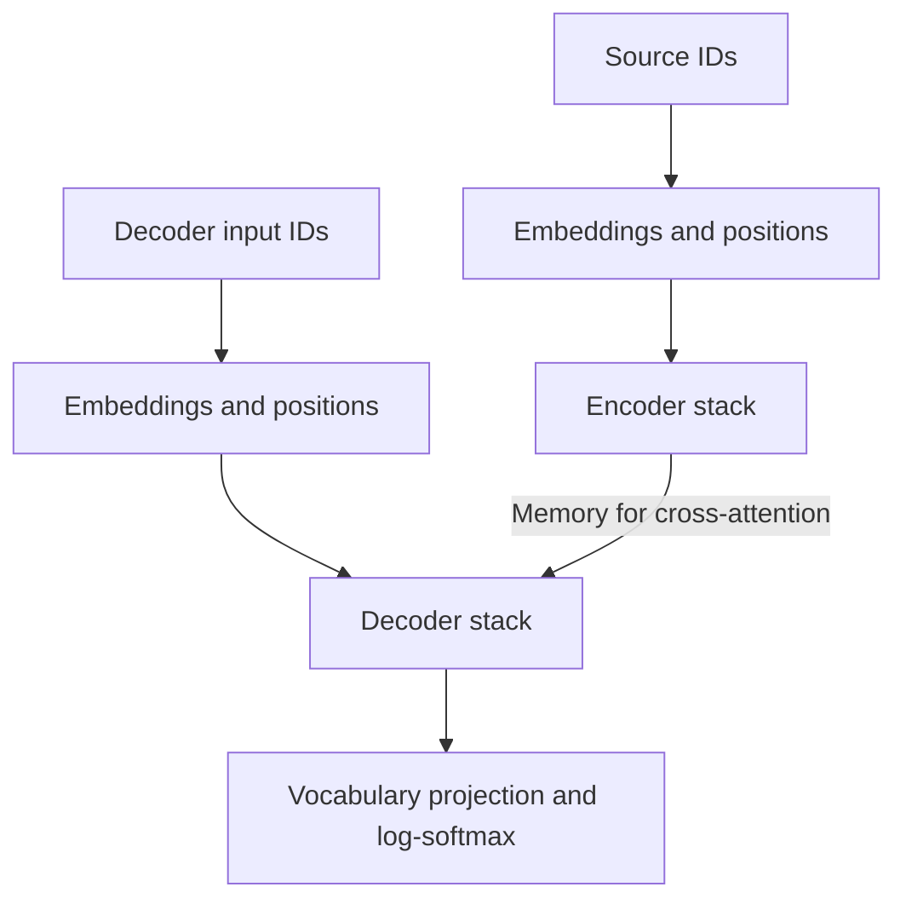

# Attention Is All You Need — Build the Transformer From Scratch

An educational PyTorch implementation of the 2017 encoder–decoder Transformer. The 80 numbered exercises expose the tensor operations behind attention, the encoder and decoder, teacher-forced training, Adam, and beam search primitives. PyTorch supplies tensors and automatic differentiation. The model stores its trainable weights as tensors in dictionaries and performs the optimizer update explicitly.

## Repository map

| File | What to read it for |
| --- | --- |
| [model.py](model.py) | All 80 exercises, from whitespace tokenization to ranking finished beams |
| [scaffold.py](scaffold.py) | The toy English–French corpus, model configuration, one forward pass, six training updates, and a greedy token selection |
| [docs/index.html](docs/index.html) | Visual overview of the project stages |

## Run the toy demo

From the repository root, create an environment and install the two dependencies. The demo is designed for CPU execution.

```bash
python -m venv .venv
source .venv/bin/activate
python -m pip install numpy torch
```

The scaffold still imports `solution`, while the implementations live in `model.py`. Run it with a temporary module alias. The alias exists only for this Python process.

```bash
python - <<'PY'
import runpy
import sys

import model

sys.modules["solution"] = model
runpy.run_path("scaffold.py", run_name="__main__")
PY
```

The scaffold uses two sentence pairs, a shared 12-token vocabulary, and a model with two encoder layers and two decoder layers. The model width is 16, with two heads of width 8 and a feed-forward hidden width of 32. Look for source and target batches of shape `(2, 4)`, output log probabilities of shape `(2, 4, 12)`, and a list of six training losses. The final printed tokens come from a single argmax over the last position of each supplied target sequence. They serve as a smoke check of the output path.

## Follow one forward pass



Start in `run_transformer_forward` (step 51). Source and decoder token IDs index separate embedding tables. The forward pass scales each embedding by the square root of the model width and adds fixed sinusoidal position vectors. The encoder contextualizes the source sequence. Each decoder layer reads the target prefix through causal self-attention, then queries the encoder output through cross-attention. The final projection and log-softmax produce a log probability for every vocabulary item at every decoder position.

### Tensor shapes and masks

`B` is batch size, `S` is source length, `T` is decoder input length, `D` is model width, `H` is head count, `Dh = D / H`, and `V` is vocabulary size. Choose an even `D` divisible by `H` for this implementation.

| Tensor | Shape | Meaning |
| --- | --- | --- |
| Source / decoder IDs | `[B, S]` / `[B, T]` | Integer indices into the embedding tables |
| Source / decoder states | `[B, S, D]` / `[B, T, D]` | One vector per sequence position |
| Query / key / value heads | `[B, H, Lq, Dh]` / `[B, H, Lk, Dh]` / `[B, H, Lk, Dh]` | Per-head vectors, with query and key lengths tracked independently |
| Attention scores / weights | `[B, H, Lq, Lk]` | For each query, one score or weight per key |
| Source padding mask | `[B, 1, 1, S]` | Blocks padded source keys in encoder and cross-attention |
| Target causal mask | `[1, 1, T, T]` | Blocks future decoder keys |
| Combined target mask | `[B, 1, T, T]` | Blocks future and padded decoder keys |
| Output log probabilities | `[B, T, V]` | Log-softmax over the vocabulary axis |

In this repo, a mask value of `True` means a query may attend to that key. The padding mask acts on **keys**. Padding positions in the training labels are excluded separately when constructing the loss.

| Attention block | Query input | Key and value input | Score shape |
| --- | --- | --- | --- |
| Encoder self-attention | Encoder state | Same encoder state | `[B, H, S, S]` |
| Decoder masked self-attention | Decoder state | Same decoder state | `[B, H, T, T]` |
| Decoder cross-attention | Decoder state | Encoder output | `[B, H, T, S]` |

Attention computes `Q @ K.transpose(-1, -2)`, scales by `sqrt(Dh)), masks disallowed scores to negative infinity, and applies softmax over keys. Multiplying the weights by `V` gives one context vector per query. The heads merge back to width `D` before the output projection.

Each encoder layer applies self-attention and a position-wise feed-forward network. Each decoder layer inserts cross-attention between those two operations. Every sublayer uses post-normalization, `LayerNorm(x + sublayer(x))`. The feed-forward network maps `D → d_ff → D` with ReLU in the middle and applies the same weights independently at each position. The dropout exercise is a standalone helper.

### Weight layout and tying

`apply_linear_projection` takes weights in `[out_features, in_features]` order and evaluates `x @ weight.T`. The feed-forward helpers use their own weight layout and multiply directly by `w1` and `w2`. When weight tying is enabled, the forward path uses the same `[V, D]` tensor for target embedding lookup and vocabulary projection. The source embedding is separate. The parameter collector deduplicates tensors by object identity so Adam updates the shared weight once. Step 49 returns a transposed view as a standalone exercise, while steps 51 and 54 use the projection helper's weight layout directly.

## Follow one training update

1. **Shift the targets.** `compute_batch_training_loss` prepends BOS and drops the last target column to construct the decoder input. The original target tensor supplies the gold labels. For gold labels `[bonjour, monde, EOS, PAD]`, the decoder receives `[BOS, bonjour, monde, EOS]`.
2. **Run teacher forcing.** The decoder gets the shifted gold prefix at each position. The causal mask prevents it from seeing later inputs even though the full shifted sequence is evaluated in parallel.
3. **Smooth the labels.** For a non-padding target, the gold token receives `1 - ε`. The other eligible vocabulary entries each receive `ε / (V - 2)`. The PAD column is zeroed everywhere and gold PAD positions contribute zero mass.
4. **Compute the loss.** Step 61 computes `-sum(target_distribution * log_probs)`, which is smoothed cross-entropy. Its name, `compute_label_smoothed_kl_loss`, reflects the exercise wording. The training loss divides by the number of non-padding labels.
5. **Backpropagate and update.** Step 72 clears stale gradients, computes loss, calls `backward()`, looks up the Noam learning rate, and applies manual Adam with bias correction. Noam warms up linearly and then decays with the inverse square root of the step. Step 73 cycles through the supplied batches and returns the scalar loss from each step.

The demo builds its target batch with BOS already present. Because the training helper also prepends BOS, the demo's shifted input begins with two BOS tokens and its gold labels include BOS. For the usual next-token objective, use target labels that begin with the first content token and end with EOS before padding, as in the example above.

## Understand decoding

**Greedy decoding.** Step 74 selects the highest-scoring token for each batch row. To generate a full sequence, begin with BOS, run the model on the growing prefix, take the last-position argmax, append it, and repeat until EOS or a length limit. The scaffold demonstrates the single selection operation.

**Beam search.** Steps 75–80 implement candidate scoring, top-k selection, sequence extension, EOS tracking, and final ranking. Candidate scores add the next-token log probability to the parent beam's cumulative log probability. The top-k helper flattens the beam-by-vocabulary matrix and recovers the parent beam and token with integer division and remainder. Finished candidates are ranked by their cumulative score divided by `((5 + length) / 6) ** alpha`. A full decoding loop would call these helpers repeatedly and manage active and finished beams.

## Study order

| Steps | Topic | Check your understanding |
| --- | --- | --- |
| 1–6 | Vocabulary and batching | Encode a sentence with an unknown word and trace padding into a batch. |
| 7–13 | Embeddings and positions | Explain why the same token can start with different vectors at different positions. |
| 14–22 | Masks and attention | Draw a three-token causal mask and trace the second query through softmax. |
| 23–31 | Multi-head attention | Trace the reshape and transpose from `[B, L, D]` to `[B, H, L, Dh]` and back. |
| 32–38 | Feed-forward, normalization, residuals, dropout | Identify which axis LayerNorm reduces and which operations mix positions. |
| 39–51 | Encoder, decoder, and forward pass | Trace cross-attention with different source and target lengths. |
| 52–55 | Initialization and parameter collection | Find the shared target embedding and output projection in the parameter list. |
| 56–63 | Target shifting, learning rate, loss, and accuracy | Write the decoder input and gold labels side by side for one padded example. |
| 64–73 | Manual Adam and training | Follow one gradient from `backward()` through Adam's moment estimates into the weight update. |
| 74–80 | Greedy and beam-search helpers | Recover the parent beam and token ID from a flattened candidate index. |

<details>
<summary>All 80 exercises</summary>

- [x] **1.** build_token_to_id_vocab
- [x] **2.** build_id_to_token_vocab
- [x] **3.** encode_sentence_to_ids
- [x] **4.** decode_ids_to_tokens
- [x] **5.** pad_id_sequence
- [x] **6.** stack_padded_sequences_to_batch
- [x] **7.** scale_embeddings_by_sqrt_d_model
- [x] **8.** compute_positional_div_term
- [x] **9.** build_position_index_column
- [x] **10.** fill_even_indices_with_sin
- [x] **11.** fill_odd_indices_with_cos
- [x] **12.** build_sinusoidal_positional_encoding
- [x] **13.** add_positional_encoding_to_embeddings
- [x] **14.** build_padding_mask
- [x] **15.** build_causal_mask
- [x] **16.** combine_padding_and_causal_masks
- [x] **17.** compute_raw_attention_scores
- [x] **18.** scale_attention_scores
- [x] **19.** mask_attention_scores_with_neg_inf
- [x] **20.** softmax_attention_weights
- [x] **21.** apply_attention_weights_to_values
- [x] **22.** scaled_dot_product_attention
- [x] **23.** split_last_dim_into_heads
- [x] **24.** transpose_heads_before_sequence
- [x] **25.** merge_heads_back_to_model_dim
- [x] **26.** apply_linear_projection
- [x] **27.** project_to_query_key_value
- [x] **28.** split_qkv_into_heads
- [x] **29.** multi_head_scaled_dot_product_attention
- [x] **30.** merge_heads_and_project_output
- [x] **31.** assemble_multi_head_attention_forward
- [x] **32.** apply_ffn_first_linear_and_relu
- [x] **33.** apply_ffn_second_linear
- [x] **34.** position_wise_feed_forward_network
- [x] **35.** compute_layer_norm_mean_and_variance
- [x] **36.** normalize_and_scale_with_gamma_beta
- [x] **37.** apply_residual_add_and_norm
- [x] **38.** apply_dropout_with_keep_mask
- [x] **39.** encoder_layer_self_attention_sublayer
- [x] **40.** encoder_layer_feed_forward_sublayer
- [x] **41.** assemble_encoder_layer
- [x] **42.** stack_encoder_layers
- [x] **43.** decoder_layer_masked_self_attention_sublayer
- [x] **44.** decoder_layer_cross_attention_sublayer
- [x] **45.** decoder_layer_feed_forward_sublayer
- [x] **46.** assemble_decoder_layer
- [x] **47.** stack_decoder_layers
- [x] **48.** apply_final_output_projection
- [x] **49.** tie_output_projection_to_token_embeddings
- [x] **50.** apply_log_softmax_over_vocab
- [x] **51.** run_transformer_forward
- [x] **52.** init_encoder_layer_parameters
- [x] **53.** init_decoder_layer_parameters
- [x] **54.** init_embedding_and_projection_parameters
- [x] **55.** collect_model_parameters_into_list
- [x] **56.** shift_targets_right_with_start_token
- [x] **57.** compute_noam_learning_rate
- [x] **58.** build_uniform_smoothing_distribution
- [x] **59.** set_confidence_on_gold_tokens
- [x] **60.** zero_pad_column_and_pad_token_rows
- [x] **61.** compute_label_smoothed_kl_loss
- [x] **62.** average_loss_over_non_pad_tokens
- [x] **63.** compute_token_accuracy_ignoring_pad
- [x] **64.** initialize_adam_optimizer_state
- [x] **65.** update_adam_first_moment
- [x] **66.** update_adam_second_moment
- [x] **67.** apply_adam_bias_correction
- [x] **68.** compute_adam_parameter_update
- [x] **69.** apply_adam_step_to_all_parameters
- [x] **70.** zero_all_parameter_gradients
- [x] **71.** compute_batch_training_loss
- [x] **72.** run_training_step_with_backprop
- [x] **73.** run_training_loop_for_steps
- [x] **74.** pick_next_token_by_argmax
- [x] **75.** compute_length_penalty
- [x] **76.** compute_candidate_scores
- [x] **77.** select_top_k_candidates
- [x] **78.** append_tokens_to_beam_sequences
- [x] **79.** mark_finished_beams
- [x] **80.** select_best_finished_beam

</details>

## Implementation notes

- Tokenization uses Python's whitespace split. The vocabulary preserves first-seen order after PAD, BOS, EOS, and UNK. Truncation keeps the first `max_len` IDs, so reserve space for EOS when building longer examples.
- Several helper tensors, including the causal mask and smoothing distribution, are created on the CPU. A GPU port needs to place them on the same device as the tensors they interact with.
- For a fully masked attention row, softmax sees all negative infinities before the implementation zeros the weights. Use batches with a valid attention key for each query when training to avoid undefined softmax gradients.
- The repository uses a repeated toy batch to demonstrate training mechanics. The six losses are training observations on those same examples.

Built on Deep-ML.
